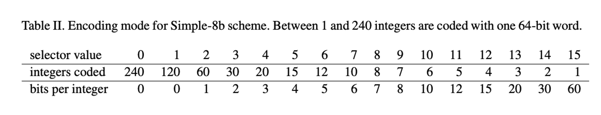

# simple8b的Go实现 

# 一、simple8b压缩原理详解

simple8b是一个整数压缩算法，用于将多个**小整数**压缩到一个 64bit长整型中存储。

正常情况下一个int64类型有64个bit，在内存中的存储格式类似于下面这样，其中每个格子表示一个bit：


上面这个看上去不是很直观，于是我们对每8个bit分为一组表示一个byte，用同一个颜色标识，这样看得更清楚一些，每个不同的颜色是一个byte，8个byte总共64个bit格子：


而simple8b就是对这64个bit的布局重新做了划分，将其分为两部分，其中前4个bit用来指定后面的bit里存储数值时的位数长度：


比如如果指定每个数值使用4个bit来表示，则后面的bit每4个为一组存储一个整数，还能存储15个整数：


比如如果指定每个整数使用10个bit来表示，则后面的bit是每10个bit一组，则能够存储6个整数：


比如如果指定每个整数使用15个bit来表示，则后面的bit是每15个一组，则能够存储4个整数：


其中前 4 位表示选择器，用来标记每个值使用多少bit，后面 60 位用于存储数据。  如上图所示，Integers Coded表示可压缩的数据集大小，Bits Per Integer表示每个整数分配多少 Bits 来表示，比如要压缩8个数据，选择器选择8，每个数据用7个 bits 表示，但是如果某个数据的值超过了7个 bits 的表示范围，那么就需要尝试用选择器9，只能压缩前7个数据，每个数据用8个bits来表示，以此类推。第一次未压缩的数据将压缩到一个新的64bit的长整型中，由此可见simple8b算法对小整数的压缩效果比较好，对大整数的压缩效果不佳。


# 二、安装使用

```bash
go get -u github.com/compression-algorithm-research-lab/go-simple8b
```


